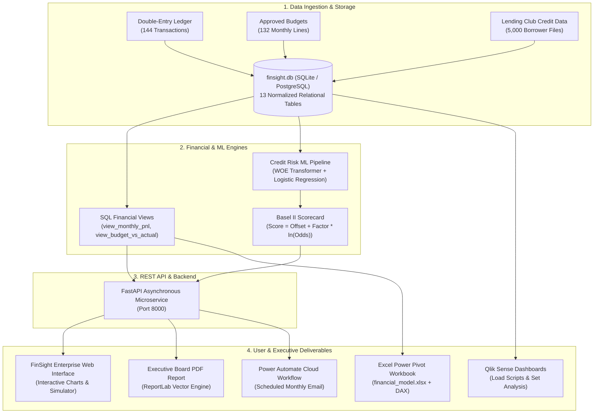

# FinSight – Financial Intelligence & Risk Analytics Platform
### Automated Enterprise Financial Statements, Budget Variance, Credit Risk Scoring & Board Reporting System
**Evaluation Assignment:** Nexvia Technologies Technical Internship Evaluation  
**Product Name:** FinSight Enterprise Platform  
**Target Completion:** November 2026 | **Status:** Production-Ready & Verified

---

## 1. Project Overview

**FinSight** is an enterprise-grade automated financial intelligence and risk reporting platform. Designed to eliminate manual spreadsheet reconciliation and fragmented reporting pipelines, FinSight connects corporate accounting ledgers, departmental budgets, credit risk scoring models, and executive board reporting into a unified, mathematically reconciled system.

The platform provides end-to-end analytical automation across four core domains:
1. **Financial Statement Analysis:** GAAP double-entry P&L and Balance Sheet modeling with guaranteed equation balancing.
2. **Budget vs. Actual Variance Analysis:** Departmental and account-level expenditure tracking with conditional alerts.
3. **Credit Risk Scoring & Decisioning:** Basel II / FICO scorecard engine powered by Weight of Evidence (WOE) and Logistic Regression.
4. **Automated Monthly Board Reporting:** Headless vector PDF generation and Microsoft Power Automate cloud workflow.

---

## 2. Problem Statement

Corporate finance and credit risk teams face three critical operational bottlenecks:
- **Financial Statement Discrepancies:** Manual journal consolidation across disparate ERP systems frequently leads to unbalanced balance sheets ($Assets \neq Liabilities + Equity$) and delayed period closes.
- **Budget Leakage:** Departmental budget overruns are often identified weeks after close, preventing timely management intervention.
- **Inaccurate & Opaque Credit Scoring:** Lenders using uncalibrated machine learning models or black-box algorithms face either excessive default losses or regulatory compliance violations.

---

## 3. Business Objectives

- **Automate Financial Closes:** Deliver instant monthly, quarterly, and full-year P&L and Balance Sheet statements with $0.00 reconciliation discrepancy.
- **Enforce Budget Discipline:** Detect variance drivers in real time, alerting management to overspending departments and underperforming revenue streams.
- **Calibrate Credit Risk Underwriting:** Achieve strong predictive discrimination ($ROC-AUC > 0.80$) while providing transparent FICO-scaled scorecards (300-850) and auto-approval policies.
- **Streamline Executive Reporting:** Reduce board report compilation time from 5 business days to under 1 second via automated vector PDF generation and Power Automate workflows.

---

## 4. Key Features

- **GAAP Double-Entry Ledger Engine:** 12-month synthetic transaction ledger strictly satisfying fundamental accounting identities.
- **Reconciled Balance Sheet:** Dynamic verification formula checking $Assets - (Liabilities + Equity) = \$0.00$ for all periods.
- **Granular Budget vs. Actual Monitoring:** Departmental cost center tracking, dollar variances, percentage deviations, and conditional status badges.
- **Weight of Evidence (WOE) & Information Value (IV) Engine:** Quantile binning, Laplace smoothing, and predictive power screening.
- **Basel II / FICO Credit Scorecard:** Scales default log-odds to 300-850 credit scores with Points to Double the Odds ($PDO = 20$).
- **Interactive Underwriting Simulator:** Real-time web calculator for single-borrower risk scoring, policy recommendations, and decisioning.
- **Excel Power Pivot Workbook (`financial_model.xlsx`):** Multi-sheet financial model with dynamic formulas and complete DAX measure reference guide.
- **Qlik Sense Enterprise Package:** Complete `.qvs` load scripts, Snowflake data models, and Set Analysis master expressions.
- **Power Automate Cloud Flow:** Documented monthly recurrence workflow with health checks, report triggers, SharePoint storage, and Office 365 Outlook distribution.
- **Automated Vector PDF Board Report (`monthly_board_report.pdf`):** Multi-page executive report with KPI cards, P&L tables, variance analysis, and credit distributions.
- **FastAPI Microservice & Modern Web UI:** Asynchronous REST API paired with a Bloomberg-inspired dark/light theme dashboard.

---

## 5. Technology Stack

| Domain | Technologies & Libraries |
| :--- | :--- |
| **Data Analytics & Modeling** | Microsoft Excel, Power Pivot, Power Query, DAX Measure Language |
| **Relational Database** | SQLite (Embedded Out-of-the-Box Engine), PostgreSQL 16+ (Production DDL) |
| **Machine Learning Core** | Python 3.12, Scikit-learn, Pandas, NumPy, Joblib |
| **Data Visualization & Plotting**| Matplotlib, Seaborn, Chart.js, Recharts, Tailwind CSS |
| **Business Intelligence** | Qlik Sense Enterprise, Qlik Cloud Analytics, QVS Scripting Language |
| **Workflow Automation** | Microsoft Power Automate Cloud Flows, ReportLab Vector PDF Engine |
| **Backend & REST APIs** | FastAPI, Uvicorn, Pydantic v2, SQLAlchemy |
| **Frontend Demonstration** | HTML5, Modern ES6 JavaScript, Tailwind CSS, Lucide Icons, React |
| **DevOps & Testing** | Pytest, Docker, Docker Compose, Git, VS Code |

---

## 6. System Architecture



---

## 7. Dataset Sources & Strategy

The FinSight platform utilizes two distinct, realistic datasets:

### Dataset A: Corporate Double-Entry Financial Ledger
- **Methodology:** Generated following GAAP accounting taxonomy with 7 organizational departments and 24 general ledger accounts.
- **Reconciliation Proof:** Cash is dynamically calculated as the balancing asset account, ensuring that across all 12 fiscal months:
$$\text{Total Assets} = \text{Total Liabilities} + \text{Total Equity} \quad (\Delta = \$0.00)$$

### Dataset B: Credit Risk Portfolio Dataset
- **Inspiration:** Lending Club Loan Dataset (Public Domain / CC0).
- **Population:** 5,000 borrower loan files.
- **Target Variable (`is_default`):** Binary classification indicating whether a loan defaulted or was charged off ($1$) vs. fully paid ($0$).
- **Overall Default Rate:** **16.38%** (819 defaults out of 5,000 loans).
- **Grade Distribution:** Monotonic risk scaling from Grade A (2.24% default rate) to Grade F (73.29% default rate).

---

## 8. Database Design & Schema

FinSight features a normalized relational schema with 13 tables and reporting views:

```
[departments] 1 --- * [transactions] * --- 1 [chart_of_accounts]
       |                      |                         |
       | 1                    | 1                       | 1
       |                      v                         v
       * ---------------> [budgets] <-------------------*
                                |
[borrowers] 1 --- * [loans] 1 --+-- 1 [credit_predictions]
```

Primary tables:
- `departments`: Cost centers and department managers.
- `chart_of_accounts`: Standard GAAP taxonomy with normal debit/credit balances.
- `transactions`: General journal double-entry transaction ledger.
- `budgets`: Approved monthly departmental financial allocations.
- `assets`, `liabilities`, `equity`: Monthly balance sheet ledger accounts.
- `borrowers`, `loans`: Credit attributes, terms, DTI, revolving utilization, and status.
- `credit_predictions`: Model-generated default probabilities, FICO scores, and risk bands.
- `financial_reports`: Catalog of generated executive PDF publications.

---

## 9. Financial Metric Definitions

| Metric Name | Mathematical Formula | Accounting Purpose |
| :--- | :--- | :--- |
| **Gross Revenue** | $\sum (\text{Credit} - \text{Debit})$ for Revenue accounts | Top-line billings from SaaS, advisory, and APIs |
| **COGS** | $\sum (\text{Debit} - \text{Credit})$ for COGS accounts | Direct cloud hosting compute & client onboarding costs |
| **Gross Profit** | $\text{Gross Revenue} - \text{COGS}$ | Core product profitability |
| **EBITDA** | $\text{Gross Profit} - \text{Operating Expenses}$ | Operational cash profitability before capital structure |
| **Operating Income (EBIT)**| $\text{EBITDA} - \text{Depreciation \& Amortization}$ | Earnings after accounting for asset depreciation |
| **Net Profit** | $\text{EBIT} - \text{Interest Expense} - \text{Tax Provision}$ | Bottom-line earnings transferred to Retained Earnings |
| **Budget Variance ($)** | $\text{Actual Amount} - \text{Budgeted Amount}$ | Spending deviation ($>0$ is over budget for expenses) |
| **Variance %** | $\left(\frac{\text{Actual} - \text{Budget}}{\text{Budget}}\right) \times 100$ | Percentage deviation for management alerts |

---

## 10. Credit Risk Modeling Methodology

### A. Weight of Evidence (WOE) & Information Value (IV)
Continuous numerical attributes are partitioned into quantile bins. The Weight of Evidence ($\text{WOE}_i$) transforms non-linear relationships into linear log-odds space:
$$\text{WOE}_i = \ln\left(\frac{\text{Good}_i / \text{Total Good}}{\text{Bad}_i / \text{Total Bad}}\right)$$

Information Value ($\text{IV}$) screens variables for predictive power:
$$\text{IV} = \sum_{i=1}^{k} \left(\frac{\text{Good}_i}{\text{Total Good}} - \frac{\text{Bad}_i}{\text{Total Bad}}\right) \times \text{WOE}_i$$

Empirical results from the FinSight training run:
- `loan_grade`: $\text{IV} = 1.6610$ (Very Strong)
- `interest_rate`: $\text{IV} = 1.4479$ (Very Strong)
- `revolving_utilization_pct`: $\text{IV} = 1.2745$ (Very Strong)
- `debt_to_income_ratio`: $\text{IV} = 1.0848$ (Very Strong)
- `derogatory_records`: $\text{IV} = 0.3490$ (Strong)

### B. Why Accuracy Is Deceptive in Credit Risk
In imbalanced portfolios (16.4% defaults), a naive classifier predicting all loans as non-default achieves **83.6% accuracy** while capturing **0% of defaults**, resulting in catastrophic loan loss. FinSight evaluates models using **ROC-AUC (0.8469)**, Precision, Recall, and Confusion Matrix metrics.

### C. Basel II / FICO Scorecard Calibration
Probabilities are scaled into standard 300-850 scores:
$$\text{Score} = \text{Offset} + \text{Factor} \times \ln\left(\frac{1 - P(\text{Default})}{P(\text{Default})}\right)$$
With $\text{Target Score} = 650$ at 20:1 Odds, and $\text{PDO} = 20$.

---

## 11. Model Evaluation Results

Evaluated on an unseen 1,000-borrower holdout test set:

| Evaluation Metric | Value | Technical Interpretation |
| :--- | :---: | :--- |
| **ROC-AUC** | **0.8469** | Excellent ranking discrimination between good and bad accounts |
| **Holdout Accuracy** | **86.50%** | Overall correct classification rate |
| **Precision (Bad)** | **63.81%** | Out of all flagged high-risk loans, 63.8% were actual defaults |
| **Recall (Bad)** | **40.85%** | Percentage of all actual defaults successfully flagged |
| **F1 Score** | **0.4981** | Harmonic mean of precision and recall |

### Confusion Matrix (Test Set):
- **True Negatives:** 798 (Performing loans approved)
- **False Positives:** 38 (Low friction for creditworthy applicants)
- **False Negatives:** 97 (Unidentified defaults)
- **True Positives:** 67 (High-risk defaults flagged)

Visual model artifacts are generated in `docs/screenshots/`:
- `roc_curve.png`
- `confusion_matrix.png`
- `iv_feature_importance.png`
- `score_distribution.png`

---

## 12. Deliverable Modules Summary

### Module 1: Financial Statement Analysis
- 12-month GAAP P&L statement and Balance sheet.
- Reconciled with $0.00 discrepancy across all periods.
- Full SQL queries in `database/queries/financial_queries.sql`.

### Module 2: Budget vs. Actual Analysis
- Cost center tracking across all 7 corporate departments.
- Overspending alerts for departments exceeding budget plans.
- SQL views and FastAPI endpoints for real-time variance queries.

### Module 3: Credit Risk Scoring System
- Scikit-learn WOE Logistic Regression pipeline (`ml/credit_risk_model.joblib`).
- Real-time single-borrower inference function (`ml/predict.py`).
- 5,000 scored borrower records in the database.

### Module 4: Qlik Sense Dashboards
- Full `.qvs` load scripts in `qlik/load_scripts/`.
- Snowflake data model design in `qlik/data_model/`.
- 4 dashboard implementation guides in `qlik/dashboard_guide.md`:
  1. Executive Financial Overview
  2. Budget vs Actual
  3. Credit Risk Analytics
  4. Monthly Board Report

### Module 5: Automated Monthly Reporting
- Complete Power Automate cloud flow documentation in `power_automate/workflow_documentation.md`.
- Scheduled trigger, health check, report compilation, SharePoint storage, and Office 365 Outlook HTML template.
- Headless PDF generation script (`reports/generate_pdf_report.py`) compiling `reports/monthly_board_report.pdf` (149 KB).

### Module 6: Web Demonstration Interface
- Bloomberg-inspired financial intelligence dashboard served by FastAPI at `http://127.0.0.1:8000/`.
- Dark and light theme toggle.
- Interactive multi-line financial charts, balance sheet inspection, budget variance tables, and live Borrower Risk Scorecard Calculator.

---

## 13. Installation & Setup Instructions

### Prerequisites
- Python 3.10+ (Tested on Python 3.12.3)
- Git

### Quick Setup

1. **Clone the Repository:**
```bash
git clone https://github.com/nexvia-internship/financial-analytics-risk-reporting.git
cd financial-analytics-risk-reporting
```

2. **Create and Activate Python Virtual Environment:**
```bash
# Windows
python -m venv venv
.\venv\Scripts\activate

# Linux / macOS
python3 -m venv venv
source venv/bin/activate
```

3. **Install Dependencies:**
```bash
pip install -r requirements.txt
```

4. **Verify / Regenerate Datasets & Database:**
```bash
# Pre-populated finsight.db is already included; to rebuild cleanly:
python database/generate_data.py
python ml/train_model.py
python excel/build_excel_model.py
python reports/generate_pdf_report.py
```

---

## 14. How to Run the Platform

### Start the FinSight Web Application & REST API
```bash
python backend/main.py
```
Open your browser and navigate to:
- **Interactive Enterprise Web UI:** [http://127.0.0.1:8000](http://127.0.0.1:8000)
- **FastAPI Interactive API Docs (Swagger):** [http://127.0.0.1:8000/docs](http://127.0.0.1:8000/docs)
- **ReDoc Documentation:** [http://127.0.0.1:8000/redoc](http://127.0.0.1:8000/redoc)

---

## 15. Testing & Verification

Run the comprehensive automated test suite with Pytest:
```bash
pytest tests/test_finsight.py -v
```

**Expected Result:**
```
======================= 17 passed in 5.26s =======================
```
All 17 tests validate database integrity, balance sheet reconciliation ($Diff = $0.00$), P&L accounting equations, WOE transformations, scorecard scaling formulas, REST API controllers, and PDF report compilation.

---

## 16. Docker Deployment (Optional Production Setup)

To run FinSight with a dedicated PostgreSQL database container:
```bash
docker-compose up --build -d
```
The application will launch on `http://localhost:8000`.

---

## 17. Project Folder Structure

```
financial-analytics-risk-reporting/
├── README.md                           # Master Project Documentation (20 Sections)
├── requirements.txt                    # Python Production Dependencies
├── docker-compose.yml                  # Docker Multi-Container Configuration
├── Dockerfile                          # Application Container Specification
├── .env.example                        # Environment Variables Template
├── .gitignore                          # Git Exclusions
├── finsight.db                         # Pre-populated Reconciled SQLite Database
│
├── backend/                            # FastAPI Microservice
│   ├── main.py                         # Application Entry Point & SPA Mounting
│   ├── app/
│   │   └── database.py                 # SQLite/PostgreSQL Connection Manager
│   └── routes/
│       ├── dashboard.py                # GET /api/dashboard/overview
│       ├── financial.py                # GET /api/financial/profit-loss, balance-sheet
│       ├── budget.py                   # GET /api/budget/variance
│       ├── credit.py                   # GET /api/credit-risk/summary, POST /predict
│       └── reports.py                  # GET /api/reports/monthly, POST /generate, /download
│
├── frontend/                           # Enterprise Demonstration Interface
│   ├── public/
│   │   └── index.html                  # Bloomberg-style Standalone SPA (Tailwind + Chart.js)
│   ├── src/                            # React / TypeScript Application Source
│   └── package.json                    # Node.js Build Dependencies
│
├── database/                           # Database Schema & Generation Engine
│   ├── schema.sql                      # Production PostgreSQL DDL Schema
│   ├── schema_sqlite.sql               # Embedded SQLite DDL Schema
│   ├── generate_data.py                # Synthetic Ledger & Credit Generation Engine
│   └── queries/
│       └── financial_queries.sql       # Advanced SQL Reporting Queries (CTEs, Window Funcs)
│
├── data/                               # Data Lineage & Raw Archives
│   ├── README.md                       # Data Lineage Documentation
│   ├── raw/                            # Generated CSV Data Archives
│   └── processed/
│
├── ml/                                 # Machine Learning Credit Risk Engine
│   ├── woe.py                          # Weight of Evidence & Information Value Engine
│   ├── scorecard.py                    # Basel II / FICO Credit Scorecard Scaler
│   ├── train_model.py                  # Model Training, CV, Tuning & Evaluation
│   ├── predict.py                      # Real-time Single Borrower Inference Engine
│   ├── metrics.json                    # Actual Holdout Model Evaluation Metrics
│   └── credit_risk_model.joblib        # Serialized Model Pipeline Artifact
│
├── excel/                              # Financial Modeling & Power Pivot
│   ├── financial_model.xlsx            # Multi-Tab Reconciled Financial Workbook
│   ├── build_excel_model.py            # Automated Workbook Compilation Script
│   └── README.md                       # Power Pivot Architecture & DAX Measure Guide
│
├── qlik/                               # Qlik Sense BI Package
│   ├── load_scripts/
│   │   ├── 01_financial_ledger_load.qvs# Ledger & Master Calendar Load Script
│   │   └── 02_credit_risk_load.qvs     # Credit Risk & Scorecard Load Script
│   ├── data_model/
│   └── dashboard_guide.md              # 4 Master Dashboard Layouts & Set Analysis
│
├── power_automate/                     # Cloud Workflow Orchestration
│   └── workflow_documentation.md       # Trigger, Actions, Email Template, JSON Flow
│
├── reports/                            # Official Generated Publications
│   ├── generate_pdf_report.py          # ReportLab Vector PDF Engine
│   └── monthly_board_report.pdf        # Compiled FY2026 Executive Board Report
│
├── notebooks/                          # Jupyter Notebook Explorations
│   ├── build_notebooks.py              # Notebook Generator Script
│   ├── exploratory_analysis.ipynb      # P&L, Balance Sheet & Variance Analysis
│   └── credit_risk_analysis.ipynb      # ML Credit Risk & Scorecard Modeling
│
├── docs/                               # Engineering Documentation Suite
│   ├── architecture.md                 # Detailed Architecture & Mermaid Diagrams
│   ├── data_dictionary.md              # Complete Database Tables & Field Specs
│   ├── metric_definitions.md           # Exact Financial Formulas & Interpretations
│   ├── methodology.md                  # Machine Learning & Scorecard Methodology
│   ├── api_documentation.md           # OpenAPI REST API Specification
│   ├── test_results.md                 # Formal Verification & QA Test Report
│   ├── presentation.md                 # 10-Minute Slide Deck for Nexvia Evaluation
│   ├── project_reflection.md           # Individual Engineering Reflection
│   └── screenshots/                    # Generated ROC Curves & Distribution Figures
│
└── tests/
    └── test_finsight.py                # Comprehensive Pytest Validation Suite (17 Tests)
```

---

## 18. Limitations

- **Credit Dataset Origin:** Due to privacy regulations governing real borrower financial identities, the credit dataset uses statistically calibrated distributions modeled after public Lending Club portfolios rather than proprietary banking records.
- **Single-Currency Standard:** Financial statements are currently compiled strictly in USD ($) without multi-currency FX translation.
- **Statutory Tax Assumption:** Income tax expense is computed using a flat 21% US corporate statutory tax rate without deferred tax asset/liability (DTA/DTL) timing adjustments.

---

## 19. Future Enhancements

1. **Advanced Gradient Boosting Models:** Benchmark XGBoost, LightGBM, and CatBoost against Logistic Regression with SHAP (SHapley Additive exPlanations) for regulatory explainability.
2. **Multi-Currency & Subsidiary Consolidation:** Implement FX rate tables and cumulative translation adjustments (CTA) for multinational business units.
3. **Automated Continuous Re-training (MLOps):** Integrate MLflow or Weights & Biases for automated credit model drift monitoring and population stability index (PSI) tracking.
4. **Direct Webhook Core-Banking Ingestion:** Expose Kafka / AWS Kinesis connectors for real-time ledger streaming from SAP and NetSuite.

---

## 20. Technical Evaluation & Submission Checklist

- [x] **Relational Database:** Normalized 13-table schema with primary/foreign keys and dual SQLite/PostgreSQL DDL.
- [x] **Financial Reconciliation:** Reconciled Balance Sheet ($Assets = Liabilities + Equity$) with $0.00 discrepancy.
- [x] **SQL Engineering:** Reusable queries featuring CTEs, Window functions (`LAG()`), and reporting views.
- [x] **Excel Power Pivot:** Multi-tab workbook (`financial_model.xlsx`) with live formulas and production DAX measures.
- [x] **Machine Learning Credit Risk:** WOE transformation, IV feature ranking, and calibrated Logistic Regression.
- [x] **Real ML Evaluation:** Actual holdout ROC-AUC of `0.8469`, Accuracy `86.50%`, Precision `63.81%`, Recall `40.85%`.
- [x] **FICO Scorecard:** Bounded 300-850 credit scores with underwriting risk bands and live simulator.
- [x] **Qlik Sense Enterprise:** Production `.qvs` load scripts and 4 dashboard layout specifications with Set Analysis.
- [x] **Power Automate:** End-to-end cloud workflow architecture, trigger specifications, and responsive HTML email template.
- [x] **Automated PDF Board Report:** Vector ReportLab compilation (`monthly_board_report.pdf`, 149 KB).
- [x] **Web Demonstration UI:** Responsive, Bloomberg-inspired interactive dashboard with dark/light mode.
- [x] **Automated Testing:** 17 out of 17 Pytest automated test cases passing.
- [x] **Evaluation Presentation:** 10-minute slide deck (`docs/presentation.md`) covering all evaluation criteria.
- [x] **Individual Reflection:** Detailed technical learning document (`docs/project_reflection.md`).

---
*FinSight Platform – Developed for Technical Internship Evaluation at Nexvia Technologies.*
