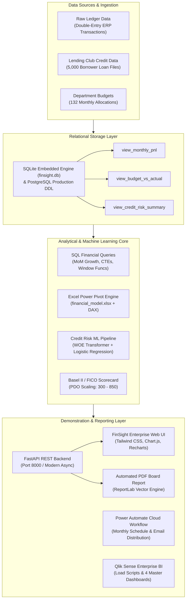

# FinSight – System Architecture & Technical Design

## 1. System Overview

**FinSight** is an end-to-end Financial Intelligence and Credit Risk Analytics platform engineered to automate corporate financial statement analysis, budget deviation monitoring, machine learning credit default modeling, and executive board reporting.

---

## 2. Component Architecture

### A. Data Ingestion & Storage Architecture
- **Normalized Relational Schema**: 13 tables enforcing primary/foreign key referential integrity.
- **Strict Double-Entry Guarantee**: Every transaction balances debit and credit allocations. Cash acts as the reconciling balance ensuring:
$$\text{Total Assets} = \text{Total Liabilities} + \text{Total Equity} \quad (\Delta = \$0.00)$$
- **Portability**: Dual-engine DDL supporting both zero-dependency embedded **SQLite** (bundled in repository) and enterprise **PostgreSQL 16+**.

### B. Analytical & Machine Learning Core
- **Financial Calculation Engine**: Computes GAAP P&L statement items:
$$\text{Gross Profit} = \text{Revenue} - \text{COGS}$$
$$\text{EBITDA} = \text{Gross Profit} - \text{Operating Expenses}$$
$$\text{Operating Income (EBIT)} = \text{EBITDA} - \text{Depreciation \& Amortization}$$
$$\text{Profit Before Tax (EBT)} = \text{EBIT} - \text{Interest Expense}$$
$$\text{Net Profit} = \text{EBT} - \text{Income Tax Provision}$$
- **Weight of Evidence (WOE) Engine**: Quantile binning that linearizes relationships with the default target and isolates Information Value (IV).
- **Credit Scorecard Engine**: Scales logistic regression probabilities to industry standard credit scores:
$$\text{Score} = \text{Offset} + \left(\frac{\text{PDO}}{\ln(2)}\right) \times \ln\left(\frac{1 - P(\text{Default})}{P(\text{Default})}\right)$$

### C. Application & Delivery Layer
- **FastAPI REST API**: High-performance asynchronous microservice providing endpoints for financial KPIs, budget variance, borrower inference, and PDF report compilation.
- **Enterprise Web UI**: Responsive, Bloomberg-inspired demonstration interface with dark/light themes, interactive charts, and real-time borrower credit simulator.
- **Automated Reporting**: Headless vector PDF generation engine with dynamic page numbering and executive sign-off blocks.
- **Power Automate Cloud Architecture**: Fully documented monthly cron recurrence flow orchestrating data health validation, report compilation, and Office 365 Outlook distribution.
