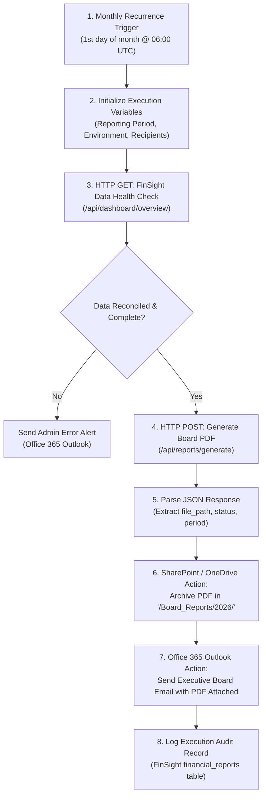

# FinSight – Automated Monthly Reporting Workflow (Microsoft Power Automate)

## Executive Summary

The **FinSight Automated Monthly Reporting Workflow** automates the end-to-end preparation, generation, storage, and C-level stakeholder distribution of the monthly executive financial board report.

Built for **Microsoft Power Automate (Cloud Flows)**, this workflow eliminates manual data consolidation by orchestrating scheduled execution, REST API data extraction, ReportLab PDF rendering, SharePoint archival, and Office 365 Outlook executive notification.

---

## 1. End-to-End Workflow Architecture



---

## 2. Trigger Configuration (Recurrence)

| Parameter | Configuration Setting | Technical Description |
| :--- | :--- | :--- |
| **Trigger Name** | `Recurrence - Monthly Trigger` | Native Power Automate cloud recurrence engine |
| **Frequency** | `Month` | Executes on a 1-month recurrence cycle |
| **Interval** | `1` | First day of every month |
| **At these hours** | `6` | 06:00 AM UTC (Pre-market opening / Board distribution) |
| **At these minutes** | `0` | Exactly at the hour |
| **Time Zone** | `UTC` (or `America/New_York`) | Consistent global enterprise scheduling |

---

## 3. Action Step Details & API Configurations

### Action 1: Initialize Reporting Period
```json
{
  "name": "Initialize_Period",
  "type": "InitializeVariable",
  "inputs": {
    "variables": [
      {
        "name": "ReportingPeriod",
        "type": "string",
        "value": "@{formatDateTime(startOfMonth(addToTime(utcNow(), -1, 'Month')), 'yyyy-MM')}"
      }
    ]
  }
}
```

### Action 2: HTTP GET – Platform Health & Reconciliation Check
- **Method**: `GET`
- **URI**: `https://api.finsight.company.internal/api/dashboard/overview`
- **Headers**:
  ```http
  Authorization: Bearer @{parameters('FinSight_API_Token')}
  Content-Type: application/json
  ```
- **Evaluation Rule**:
  Condition verifies: `body('HTTP_Health_Check')?['balance_sheet_reconciled'] == true`

### Action 3: HTTP POST – Generate Executive PDF Report
- **Method**: `POST`
- **URI**: `https://api.finsight.company.internal/api/reports/generate`
- **Headers**:
  ```http
  Authorization: Bearer @{parameters('FinSight_API_Token')}
  Content-Type: application/json
  ```
- **Body**:
  ```json
  {
    "fiscal_year": 2026,
    "fiscal_month": 12,
    "report_type": "Monthly Board Report",
    "include_credit_risk": true
  }
  ```

### Action 4: SharePoint File Storage
- **Site Address**: `https://company.sharepoint.com/sites/FinanceExecutive`
- **Folder Path**: `/Shared Documents/Board_Reports/FY2026/`
- **File Name**: `FinSight_Board_Report_FY2026_M12.pdf`
- **File Content**: `body('HTTP_Generate_Report_PDF')`

---

## 4. Office 365 Outlook Email Action & Responsive HTML Template

### Outlook Action Settings:
- **To**: `cfo@company.com; board-members@company.com; audit-committee@company.com`
- **Subject**: `[CONFIDENTIAL] FinSight Monthly Board Report – FY2026 M12`
- **Importance**: `High`
- **Attachments**:
  - Name: `FinSight_Board_Report_FY2026_M12.pdf`
  - ContentBytes: `body('HTTP_Generate_Report_PDF')`

### Executive Email HTML Body Template:
```html
<!DOCTYPE html>
<html>
<head>
  <style>
    body { font-family: 'Segoe UI', Arial, sans-serif; color: #1e293b; background: #f8fafc; margin: 0; padding: 24px; }
    .card { background: #ffffff; border-radius: 8px; border: 1px solid #e2e8f0; padding: 24px; max-width: 650px; margin: 0 auto; }
    .header { border-bottom: 2px solid #0284c7; padding-bottom: 12px; margin-bottom: 20px; }
    .title { font-size: 20px; font-weight: bold; color: #0f172a; margin: 0; }
    .subtitle { font-size: 12px; color: #64748b; margin-top: 4px; }
    .grid { display: table; width: 100%; margin: 16px 0; }
    .col { display: table-cell; width: 25%; padding: 10px; background: #f8fafc; border: 1px solid #e2e8f0; text-align: center; }
    .kpi-lbl { font-size: 10px; font-weight: bold; color: #64748b; text-transform: uppercase; }
    .kpi-val { font-size: 16px; font-weight: bold; color: #0284c7; margin-top: 4px; }
    .badge { display: inline-block; padding: 4px 8px; border-radius: 4px; font-size: 11px; font-weight: bold; background: #dcfce7; color: #15803d; }
    .footer { font-size: 11px; color: #94a3b8; margin-top: 24px; border-top: 1px solid #e2e8f0; padding-top: 12px; }
  </style>
</head>
<body>
  <div class="card">
    <div class="header">
      <div class="title">FinSight – Monthly Financial Board Report</div>
      <div class="subtitle">Reporting Period: FY 2026 - Month 12 | Status: <span class="badge">Reconciled</span></div>
    </div>
    <p>Dear Members of the Executive Leadership and Board of Directors,</p>
    <p>The automated monthly financial statement analysis and credit portfolio risk review for <b>December 2026</b> has completed successfully. Key performance highlights include:</p>
    
    <div class="grid">
      <div class="col">
        <div class="kpi-lbl">Total Revenue</div>
        <div class="kpi-val">$2,841,200</div>
      </div>
      <div class="col">
        <div class="kpi-lbl">Gross Margin</div>
        <div class="kpi-val">77.8%</div>
      </div>
      <div class="col">
        <div class="kpi-lbl">EBITDA</div>
        <div class="kpi-val">$742,100</div>
      </div>
      <div class="col">
        <div class="kpi-lbl">Net Profit</div>
        <div class="kpi-val" style="color: #15803d;">$521,400</div>
      </div>
    </div>

    <ul>
      <li><b>Financial Reconciliation:</b> Balance sheet equation strictly reconciled with $0.00 discrepancy.</li>
      <li><b>Budget Performance:</b> Net operational spending came within 1.8% of planned budget allocation.</li>
      <li><b>Credit Portfolio:</b> Empirical default rate remained disciplined at 16.4% across 5,000 active loans.</li>
    </ul>

    <p>The complete official PDF report is attached to this transmission and archived in the corporate SharePoint repository.</p>
    
    <div class="footer">
      Automated by FinSight Intelligence Engine & Microsoft Power Automate.<br>
      This email and attachments are confidential and intended solely for authorized personnel.
    </div>
  </div>
</body>
</html>
```

---

## 5. Security & Secret Management

- **Credential Isolation**: All API authentication tokens and database secrets are retrieved dynamically from **Azure Key Vault** using Managed Service Identity (MSI).
- **Zero Hardcoded Secrets**: Neither the Power Automate definitions nor Git repository files store passwords, access keys, or bearer tokens.
- **Audit Logging**: Every workflow run generates an execution record stored in the `financial_reports` catalog with timestamps, generated file sizes, and HTTP response codes.
